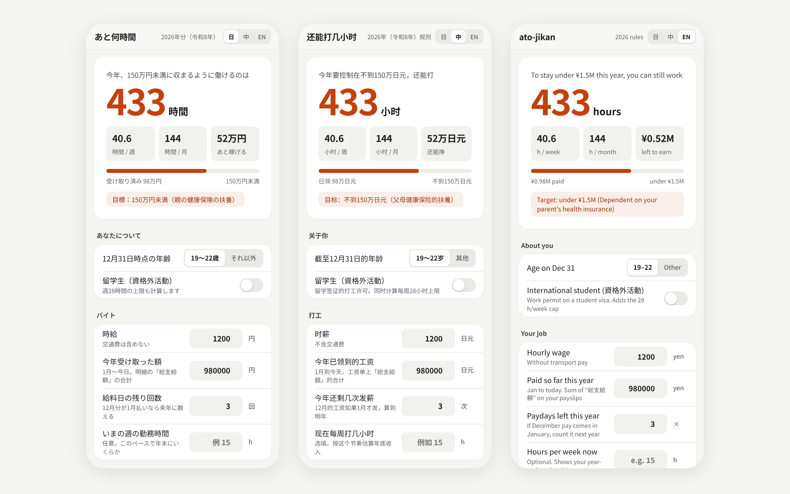

# ato-jikan — "How many more hours?"

[日本語](README.md) ・ [中文](README.zh.md)

A tool for students with part-time jobs in Japan: it works out **how many more hours you can work this year without crossing the dependent-income thresholds ("年収の壁") under the 2026 rules**. It also applies the 28-hours-a-week limit for international students and makes a shareable 1600×2000 result image.

**▶ Try it:** https://jasonin2099.github.io/ato-jikan/

## Features
- Remaining hours from your hourly wage, gross pay so far this year and remaining paydays
- The 1.36M / 1.5M / 1.59M / 1.78M / 1.97M yen thresholds, each linked to an official source
- A year-end projection at your current weekly hours, and how your parent's deduction changes
- International-student mode: 28 h/week during term, 40 h/week during long vacations
- Japanese / Chinese / English (follows your browser, remembers your choice), dark mode
- Everything runs on your device. Nothing is sent anywhere.

## Rules and sources
All numbers live in [`rules/2026.json`](rules/2026.json). Each entry cites its official source (National Tax Agency No.1177 / 1410 / 1199 / 1180, the 2026 tax reform, Japan Pension Service, Immigration Services Agency) and its year.

## Disclaimers
- **Resident tax (住民税) is not calculated**, because its exemption line differs by municipality.
- **The long-vacation limit uses a conservative 40 h/week** (8 h/day; Labour Standards Act Art. 32).
- Salary income only. Tax thresholds use the amount **paid** from January to December. The health-insurance dependency test uses **expected income over the next 12 months**, which may include commuting allowance.
- These are estimates. Check with your employer, your parent's health insurer, the tax office or immigration. The author accepts no liability.

## Development
`npm test` (Node 18+). `calc.js` is a pure module that works in both the browser and Node. Add `rules/2027.json` for the next year. Corrections are welcome as issues or PRs; please include the source.

## License
MIT

Icons: [Lucide](https://lucide.dev) (ISC License), inlined as SVG.
